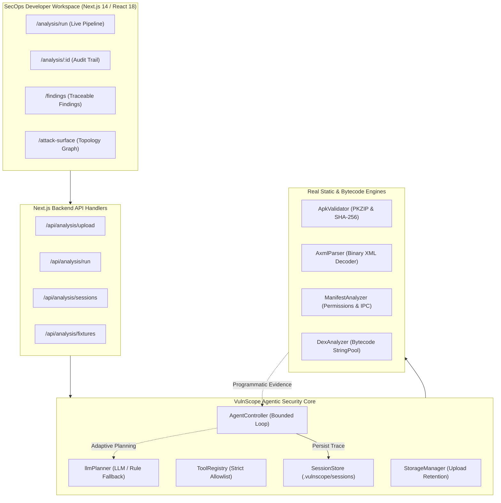

# VulnScope — Autonomous Mobile Application Security Testing & Penetration Testing Framework

[](https://nextjs.org/)
[](https://www.typescriptlang.org/)
[](https://github.com/mabubakarali/sentinelx/actions)
[](https://mas.owasp.org/MASVS/)
[](https://vulnscope-fyp.vercel.app/)

> **Live Production Workspace:** [https://vulnscope-fyp.vercel.app/](https://vulnscope-fyp.vercel.app/)  
> **Final Year Project (FYP-1 Mid-Supervisory Evaluation 01)**  
> **School of Computing — National University of Computer and Emerging Sciences (FAST-NUCES)**

---

## 👥 Project Team

| Student Name | Roll Number | Primary Engineering Ownership |
| :--- | :--- | :--- |
| **Muhammad Abubakar Ali** | **22i-2693** | System Architecture, Agentic Controller Loop, Allowlisted Tool Registry & CI/CD Pipeline |
| **Yasir Suhail** | **23i-0566** | In-Process Static Security Analyzers, Binary AXML Decoder & Dalvik DEX Bytecode Scanner |
| **Amna Malik** | **22i-2715** | Developer Workspace UI/UX, Findings Correlation, Attack Surface Graphs & OWASP MASVS Mapping |

---

## 🎯 Executive Summary & Purpose

Modern mobile application security testing is frequently bottlenecked by static, disconnected tool outputs or naive LLM wrappers that hallucinate nonexistent vulnerabilities without technical evidence. 

**VulnScope** is an evidence-grounded, autonomous mobile security testing platform for Android (with iOS architecture support). It places an LLM-assisted planner **directly inside an active, observation-driven decision loop**:
1. **Intake & Verification:** Performs PKZIP integrity validation, SHA-256 fingerprinting, and containment sanitization on uploaded packages.
2. **Deconstruction:** Operates pure in-process compiled Android binary XML (`AxmlParser`) and Dalvik executable (`DexAnalyzer`) decompilation engines with zero external binary dependencies.
3. **Adaptive Agentic Loop:** Iteratively executes allowlisted security actions, observes concrete programmatic outputs, and adapts subsequent actions based on verified evidence.
4. **Traceable Findings:** Every reported vulnerability contains verified technical evidence (exact XML attribute or decompiled DEX string token), CWE attribution, and OWASP MASVS v2.0 category mapping.
5. **Zero-Hallucination Fallback:** Features a deterministic, rule-based adaptive controller that provides 100% offline, reproducible analysis without requiring external API keys.

---

## 🌐 Live Product Demo

Access the live interactive deployment hosted on Vercel:
👉 **[https://vulnscope-fyp.vercel.app/](https://vulnscope-fyp.vercel.app/)**

### 1-Click Evaluation Benchmarks Included:
- **Insecure Bank Benchmark (`com.vulnscope.insecurebank`):** Demonstrates real detection of `android:debuggable="true"`, `usesCleartextTraffic="true"`, unprotected exported IPC Services/Receivers, and hardcoded Google/AWS cloud API credentials compiled in `classes.dex`.
- **Hardened Vault Benchmark (`com.vulnscope.securevault`):** Negative baseline proving zero false-positive generation, producing a verified **Grade A** security posture.

---

## 🏗️ System Architecture & Autonomous Agent Decision Loop



### The Autonomous "Plan-Act-Observe-Adapt" Decision Cycle:

```
                      ┌──────────────────────┐
                      │ Target APK Uploaded  │
                      └──────────┬───────────┘
                                 │
                                 ▼
                      ┌──────────────────────┐
                      │ 01. Validate APK &   │
                      │ Compute SHA-256      │
                      └──────────┬───────────┘
                                 │
                                 ▼
        ┌──────────────────────────────────────────────────┐
        │  Agent Controller: Select Allowlisted Action     │◄─────────┐
        └────────────────────────┬─────────────────────────┘          │
                                 │                                    │
                                 ▼                                    │
        ┌──────────────────────────────────────────────────┐          │
        │  Execute Action via Sandboxed Tool Registry      │          │
        └────────────────────────┬─────────────────────────┘          │
                                 │                                    │
                                 ▼                                    │
        ┌──────────────────────────────────────────────────┐          │ (Adaptive
        │  Observe Real Tool Output & Extract Evidence     │          │  Iteration)
        └────────────────────────┬─────────────────────────┘          │
                                 │                                    │
                                 ▼                                    │
        ┌──────────────────────────────────────────────────┐          │
        │  Are subsequent actions warranted?               │──────────┘
        │  (e.g., Cleartext flag triggers Network audit;   │   YES
        │   Exported IPC triggers Component scan)          │
        └────────────────────────┬─────────────────────────┘
                                 │ NO / Max Steps Reached
                                 ▼
        ┌──────────────────────────────────────────────────┐
        │  Compile Verified Findings & Save Session Audit │
        └──────────────────────────────────────────────────┘
```

---

## 🛡️ Security Boundaries & Non-Functional Protections

| Security Guard | Implementation Details |
| :--- | :--- |
| **Strict Tool Allowlist** | Only registered action IDs (`ACTION_VALIDATE_APK_STRUCTURE`, `ACTION_INSPECT_MANIFEST`, `ACTION_AUDIT_PERMISSIONS`, `ACTION_ANALYZE_COMPONENTS`, `ACTION_INSPECT_NETWORK_CONFIG`, `ACTION_SCAN_DEX_SECRETS`) can execute. Arbitrary shell commands are blocked and rejected at the controller boundary. |
| **Path Traversal Containment** | Storage keys and session IDs are strictly validated with alphanumeric allowlists (`^[a-zA-Z0-9_-]{1,64}$`). Traversal sequences (`../`, null bytes, absolute paths) are immediately rejected. |
| **Upload Retention & Cleanup** | Uploaded packages are quarantined in a private unserved directory (`storage/uploads/`). Automatic maintenance prunes files older than the retention threshold (default: 24h) while respecting active analysis file locks. |
| **Package Quarantine** | Uploaded APK files are treated as untrusted data. They are inspected via pure in-process stream parsing and are never executed on the operating system. |
| **Deterministic Rule Fallback** | Does not fail when external LLM APIs (OpenAI / Gemini) are unavailable, rate-limited, or unconfigured. |

---

## 📊 OWASP MASVS v2.0 & CWE Coverage Matrix

| OWASP MASVS Category | CWE ID | Vulnerability / Indicator Description | Severity | Verification State |
| :--- | :--- | :--- | :--- | :--- |
| **MASVS-CRYPTO** | **CWE-798** | Hardcoded Google Cloud API Key in bytecode (`AIzaSy...`) | **Critical** | **Verified** |
| **MASVS-CRYPTO** | **CWE-798** | Hardcoded AWS IAM Access Key in bytecode (`AKIA...`) | **Critical** | **Verified** |
| **MASVS-PLATFORM** | **CWE-215** | Application compiled with `android:debuggable="true"` | **High** | **Verified** |
| **MASVS-NETWORK** | **CWE-319** | Cleartext HTTP traffic enabled (`android:usesCleartextTraffic="true"`) | **High** | **Verified** |
| **MASVS-PLATFORM** | **CWE-926** | Unprotected exported Services / Receivers (`android:exported="true"`) | **Medium / High** | **Detected / Verified** |
| **MASVS-CRYPTO** | **CWE-327** | Broken / Obsolete Ciphers detected in Dalvik StringPool (`DES`, `RC4`, `AES/ECB`) | **High** | **Detected** |
| **MASVS-NETWORK** | **CWE-295** | Permissive TrustManager signature (`TrustAllCerts`, `AllowAllHostnameVerifier`) | **High** | **Suspected** |
| **MASVS-STORAGE** | **CWE-312** | Application data backup permitted (`android:allowBackup="true"`) | **Low** | **Detected** |
| **MASVS-PRIVILEGE**| **CWE-250** | Dangerous permissions declared (`READ_SMS`, `ACCESS_FINE_LOCATION`, `CAMERA`) | **Medium / Low**| **Detected** |

---

## 🚀 Getting Started & Local Development

### Prerequisites
- **Node.js**: v18.17.0 or v20.x+
- **npm**: v9.x or v10.x+
- **Git**

### Installation

1. **Clone the repository:**
   ```bash
   git clone https://github.com/Muhammad-Yasir-Suhail/LLM-based-Penetration-Testing-System-for-Android-and-iOS-devices.git
   cd LLM-based-Penetration-Testing-System-for-Android-and-iOS-devices
   ```

2. **Install dependencies:**
   ```bash
   npm install
   ```

3. **Generate benchmark test fixtures:**
   ```bash
   npm run fixtures
   ```

4. **(Optional) Configure LLM API Keys:**
   Copy `.env.example` to `.env.local` if you wish to use OpenAI or Google Gemini. If left blank, VulnScope runs smoothly in **Deterministic Rule-Based Planner** mode:
   ```bash
   cp .env.example .env.local
   ```

5. **Start the local development server:**
   ```bash
   npm run dev
   ```
   Open [http://localhost:3000](http://localhost:3000) in your browser.

---

## 🧪 Verification & Acceptance Testing

VulnScope includes an automated test suite verifying all functional requirements (FR-01 through FR-07) and security boundary controls against real and synthetic benchmark packages:

```bash
npm run test:security
```

### Verified Test Suite Output (11/11 Passing):
```text
============================================================
  VULNSCOPE VERIFICATION & ACCEPTANCE TEST SUITE
  Testing Real Agentic Security Core & Tool Execution
============================================================

  [TEST] FR-01: Valid Authorized APK intake, checksum calculation, and metadata extraction ... PASSED
  [TEST] FR-01: Reject corrupt / non-ZIP archive with explicit error code ... PASSED
  [TEST] FR-01: Reject ZIP archive lacking required AndroidManifest.xml ... PASSED
  [TEST] FR-02: Enforce registered action allowlist and verify execution handler output ... PASSED
  [TEST] FR-05: Controller rejects unregistered / arbitrary shell action at security boundary ... PASSED
  [TEST] FR-03: Reject path traversal, absolute paths, and malformed session IDs with containment checks ... PASSED
  [TEST] FR-04: Observation-driven adaptive decision loop discovers real vulnerabilities and branches dynamically ... PASSED
  [TEST] FR-06: Findings accurately differentiate Verified vulnerabilities from Detected static indicators ... PASSED
  [TEST] FR-04: Hardened APK produces zero false-positive critical findings and rating A ... PASSED
  [TEST] FR-03: Persist analysis session to local storage and retrieve by ID ... PASSED
  [TEST] FR-07: Enforce APK storage key allowlist, active file locking, and retention pruning ... PASSED

============================================================
  TEST EXECUTION SUMMARY: 11 Passed, 0 Failed (100% Pass)
============================================================
```

### Production Build Verification:
```bash
npm run build
```
Compiles all 24 static and dynamic Next.js routes with zero TypeScript or ESLint errors.

---

## ⚙️ Automated CI/CD Pipeline

The project integrates GitHub Actions ([`.github/workflows/ci.yml`](.github/workflows/ci.yml)) configured to run on every push and pull request to `main` and `feat/**`:
1. **Dependency Installation:** `npm ci`
2. **Fixture Generation:** `npm run fixtures`
3. **Automated Security Verification:** `npm run test:security`
4. **Production Build Validation:** `npm run build`

---

## 📂 Project Structure

```text
├── .github/workflows/ci.yml       # Automated GitHub Actions CI/CD pipeline
├── docs/                          # Mid Evaluation 01 design artefacts & evaluation guides
│   ├── ARCHITECTURE_AND_AGENT_DECISION_LOOP.md # Sequence diagrams & system design (R5)
│   ├── EVALUATION_DEMO_AND_QA_GUIDE.md         # Live defense demo script & panel Q&A (R8)
│   ├── ITERATION_PLAN.md                       # WBS, task allocation & sprint tracking (R2)
│   ├── PROPOSAL_ACTION_REGISTER.md             # Feedback tracking & commitments (R1)
│   └── REQUIREMENTS_TRACEABILITY.md            # Traceability matrix FR-01 to FR-07 (R4)
├── fixtures/                      # Benchmarks (InsecureBank, HardenedVault, Corrupt APKs)
├── scripts/
│   ├── generate_fixtures.js       # Synthetic APK generation script
│   └── run_security_tests.ts      # Automated acceptance test suite
├── src/
│   ├── app/                       # Next.js 14 App Router pages & API handlers
│   │   ├── (dashboard)/
│   │   │   ├── analysis/          # Session audit trail & history
│   │   │   ├── analysis/run/      # Live Agentic Pipeline UI (Benchmark & Upload)
│   │   │   ├── attack-surface/    # Visual component-to-endpoint topology graph
│   │   │   ├── dashboard/         # SecOps executive dashboard
│   │   │   ├── engines/           # Security engine registry & status
│   │   │   ├── findings/          # Evidence-backed findings viewer
│   │   │   ├── reports/           # Automated security report generator
│   │   │   └── settings/          # Framework policies & API credentials
│   │   └── api/analysis/          # Backend REST APIs (run, upload, sessions, fixtures)
│   ├── components/                # Modular UI components (Sidebar, Topbar, Modals)
│   ├── context/                   # React State Context (AppStateContext)
│   ├── lib/security/              # Core Agentic & Deconstruction Engines
│   │   ├── agentController.ts     # Bounded adaptive decision loop controller
│   │   ├── apkValidator.ts        # PKZIP format, digest, & quarantine validator
│   │   ├── axmlParser.ts          # Pure in-process binary Android XML decoder
│   │   ├── dexAnalyzer.ts         # Dalvik bytecode StringPool deconstructor
│   │   ├── fixturesLoader.ts      # Resilient benchmark loader with memory fallback
│   │   ├── llmPlanner.ts          # LLM provider integration & rule-based fallback
│   │   ├── manifestAnalyzer.ts    # Android permissions & IPC audit engine
│   │   ├── sessionStore.ts        # Local session audit trail persistence
│   │   ├── storageManager.ts      # Upload quarantine, file locking & retention
│   │   └── toolRegistry.ts        # Sandboxed allowlisted security action registry
│   └── types/agent.ts             # Domain models (Session, Finding, Action, Trace)
└── package.json                   # Project manifest & scripts
```

---

## ⚖️ Ethical Guidelines & Responsible Disclosure

VulnScope is designed strictly for authorized security auditing, defensive research, and educational evaluation on owned applications or explicitly authorized test fixtures. It does not construct autonomous exploit payloads or engage in unauthorized network intrusion.

---

## 📄 License & Attribution

Developed as a university Final Year Project (FYP) for BS Software Engineering at **FAST National University of Computer and Emerging Sciences**.  
Distributed under the MIT License.