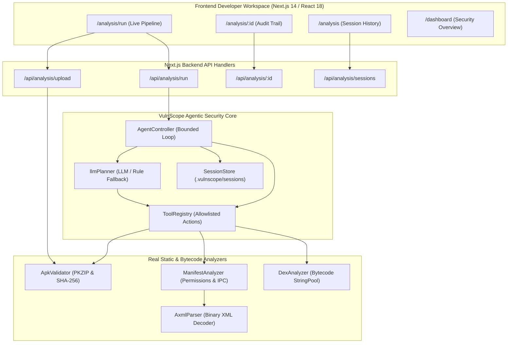
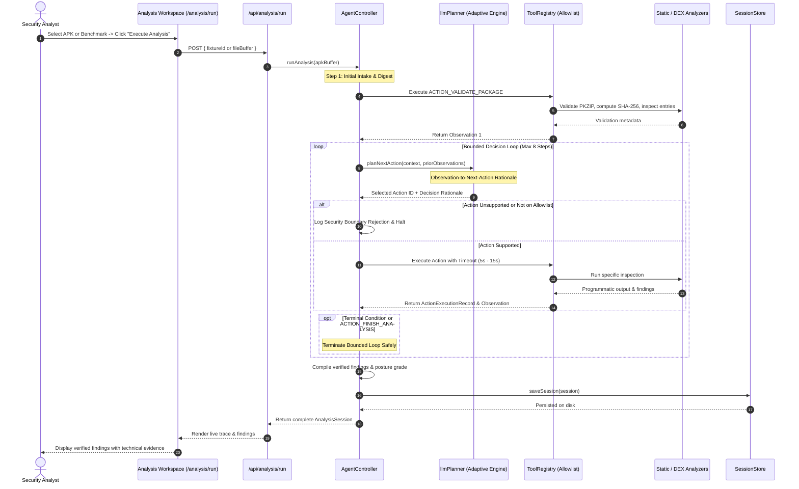
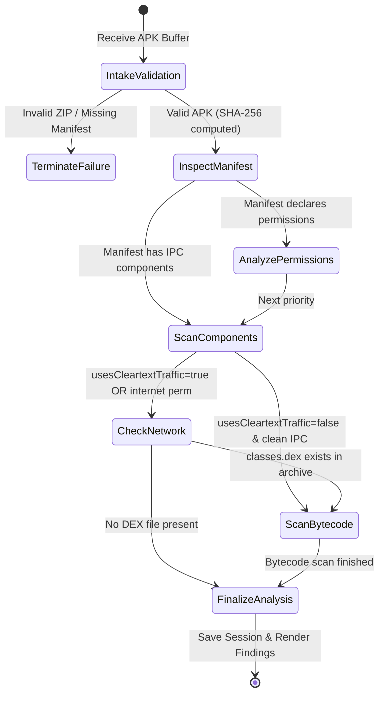

# VulnScope — System Architecture & Agent Decision Loop (R5)
**Project Title:** AI-Assisted Vulnerability Detection and Security Analysis of Mobile Applications  
**Framework Name:** VulnScope  
**Milestone Focus:** Mid Evaluation 01 Design Artefacts  
**Rubric Area:** R5 — 15 Marks

---

## 1. High-Level System Architecture

VulnScope is designed as a modular, evidence-grounded security testing framework. The frontend developer workspace communicates with the Next.js API layer, which coordinates the bounded Agent Controller, allowlisted Tool Registry, and static deconstruction engines.



---

## 2. Agent Decision & Tool Execution Sequence

The agent decision loop executes bounded, adaptive analysis steps. Every tool execution returns a concise, structured observation that is ingested into the agent context before the next action is selected.



---

## 3. Observation-Driven Adaptation Flow (State Diagram)

The hallmark of the agentic workflow is that **real observations alter the next decision**, rather than executing a hardcoded sequence:



### Demonstrable Branching Scenarios in VulnScope:
1. **Vulnerable Package Branch (`vulnerable_bank.apk`):**
   - Manifest inspection observes `android:usesCleartextTraffic="true"`, `android:debuggable="true"`, and exported components without permissions.
   - The planner adaptively schedules `ACTION_INSPECT_NETWORK_CONFIG` and `ACTION_SCAN_DEX_SECRETS` to verify the presence of cleartext endpoints and embedded credentials.
   - Result: 8+ verified findings (Grade F).
2. **Hardened Package Branch (`hardened_app.apk`):**
   - Manifest inspection observes `debuggable="false"`, `allowBackup="false"`, `usesCleartextTraffic="false"`, and 0 unprotected exported components.
   - Bytecode scan finds zero hardcoded API keys and TLS v1.3 only.
   - Result: 0 critical/high findings (Grade A).

---

## 4. Core Data Structures

### 4.1 AnalysisSession Data Model
```typescript
interface AnalysisSession {
  sessionId: string;                        // Unique identifier, e.g. "VC-SES-1718..."
  status: 'Queued' | 'Running' | 'Completed' | 'Failed';
  agentMode: 'DeterministicFallback' | 'LLMAgent';
  llmProvider?: string;                     // e.g. "Google Gemini (gemini-1.5-flash)"
  targetApk: ApkMetadata;                   // SHA-256, filename, package, SDKs
  durationSeconds: number;
  totalActionsExecuted: number;
  executionTrace: ActionExecutionRecord[];  // Full chronological history
  findings: SecurityFinding[];              // Verified findings with evidence
  summary: {
    criticalCount: number;
    highCount: number;
    mediumCount: number;
    securityPostureRating: 'A' | 'B' | 'C' | 'D' | 'F';
    summaryNarrative: string;
  };
}
```

### 4.2 ActionExecutionRecord Data Model
```typescript
interface ActionExecutionRecord {
  stepNumber: number;
  actionId: string;                        // e.g. "ACTION_INSPECT_MANIFEST"
  actionName: string;
  input: Record<string, any>;
  status: 'SUCCESS' | 'FAILURE' | 'TIMEOUT';
  startedAt: string;
  completedAt: string;
  durationMs: number;
  output: Record<string, any>;             // Structured programmatic output
  observation: string;                     // Concise summary ingested by agent
  decisionRationale: string;               // Why this action was chosen based on prior steps
  error?: string;
}
```

### 4.3 SecurityFinding Data Model
```typescript
interface SecurityFinding {
  stableId: string;                        // e.g. "VC-DEX-001"
  title: string;                           // "Hardcoded Google Cloud API Key in Bytecode"
  description: string;
  category: string;                        // "Hardcoded Credentials"
  owaspCategory: string;                   // "MASVS-CRYPTO"
  cwe: string;                             // "CWE-798"
  severity: 'Critical' | 'High' | 'Medium' | 'Low';
  confidence: 'Confirmed' | 'Suspected' | 'Inconclusive';
  verificationStatus: 'Verified' | 'Detected' | 'Suspected' | 'Inconclusive';
  evidence: string;                        // Exact extracted token or XML attribute
  location: string;                        // e.g. "classes.dex:StringPool"
  sourceTool: string;                      // "VulnScope DEX String Analyzer v1.0"
  remediation: string;
  sessionId: string;
  timestamp: string;
}
```
